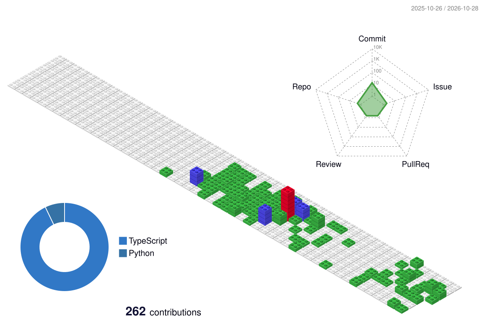

<picture>
  <source
    media="(prefers-color-scheme: dark)"
    srcset="./assets/typing-dark.svg"
  />
  <source
    media="(prefers-color-scheme: light)"
    srcset="./assets/typing-light.svg"
  />
  
</picture>

## 贡献蛇形图

<picture>
  <source
    media="(prefers-color-scheme: dark)"
    srcset="./assets/github-contribution-grid-snake-dark.svg"
  />
  <source
    media="(prefers-color-scheme: light)"
    srcset="./assets/github-contribution-grid-snake.svg"
  />
  
</picture>

## 3D 贡献图

<picture>
  <source
    media="(prefers-color-scheme: dark)"
    srcset="./profile-3d-contrib/profile-night-rainbow.svg"
  />
  <source
    media="(prefers-color-scheme: light)"
    srcset="./profile-3d-contrib/profile-gitblock.svg"
  />
  
</picture>

